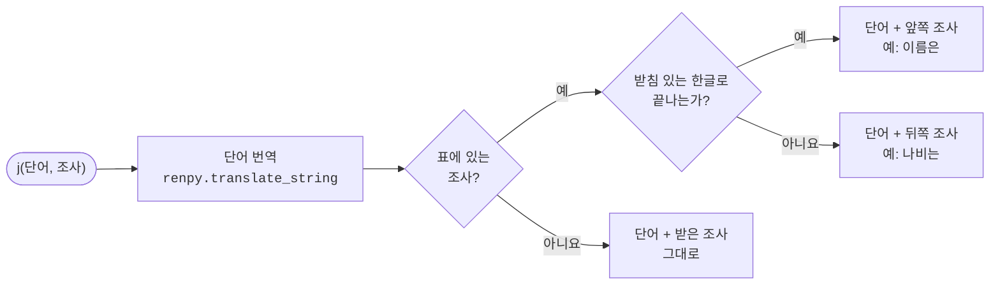

# Xeti's Korean utility plugins

[English](README.md) | **한국어**

단어 뒤에 알맞은 조사를 붙여 주는 Ren'Py 도우미입니다. 단어가 받침으로 끝나는지 보고 은/는, 이/가, 을/를 등을 고릅니다.

## 설치

`Xj.rpy`를 게임의 `game` 폴더에 넣습니다.

## 사용법

```renpy
$ subject = j(player_name, "은")
"[subject] 문을 열었다."
```

`j(단어, 조사)`는 단어 뒤에 알맞은 조사를 붙여 돌려줍니다.

- 짝의 어느 쪽을 넘겨도 됩니다. `j(name, "은")`과 `j(name, "는")`의 결과는 같습니다.
- 단어는 먼저 `renpy.translate_string`을 거치므로, 번역된 단어가 있으면 그 단어 기준으로 고릅니다.
- 단어가 `None`이거나 비어 있으면 `""`를 돌려줍니다.
- 표에 없는 조사는 그대로 붙입니다.

| 받침 있을 때 | 받침 없을 때 |
|---|---|
| 은 | 는 |
| 이 | 가 |
| 을 | 를 |
| 과 | 와 |
| 아 | 야 |
| 이여 | 여 |
| 이랑 | 랑 |
| 이나 | 나 |
| 이란 | 란 |
| 이며 | 며 |
| 이라는 | 라는 |
| 이라고 | 라고 |
| 이라면 | 라면 |
| 이에요 | 예요 |

## 한계

- 한글 음절만 봅니다. 영문자·숫자·기호로 끝나는 단어는 받침이 없는 것으로 처리합니다.
- 으로/로는 지원하지 않습니다. ㄹ 받침을 따로 처리해야 하기 때문입니다.

## 구조


