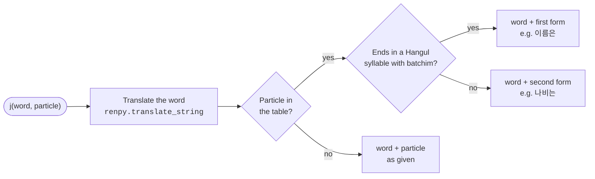

# Xeti's Korean utility plugins

**English** | [한국어](README.ko.md)

A Ren'Py helper that attaches the right Korean particle (josa) to a word. It picks the form by whether the word ends in a final consonant (batchim): 은/는, 이/가, 을/를 and so on.

## Installation

Copy `Xj.rpy` into the game's `game` folder.

## Usage

```renpy
$ subject = j(player_name, "은")
"[subject] 문을 열었다."
```

`j(word, particle)` returns the word followed by the matching particle.

- Either form of a pair works as `particle`: `j(name, "은")` and `j(name, "는")` give the same result.
- The word goes through `renpy.translate_string` first, so the translated form of the word is used when one exists.
- `None` or an empty word returns `""`.
- A particle that is not in the table is appended unchanged.

| With batchim | Without batchim |
|---|---|
| 은 | 는 |
| 이 | 가 |
| 을 | 를 |
| 과 | 와 |
| 아 | 야 |
| 이여 | 여 |
| 이랑 | 랑 |
| 이나 | 나 |
| 이란 | 란 |
| 이며 | 며 |
| 이라는 | 라는 |
| 이라고 | 라고 |
| 이라면 | 라면 |
| 이에요 | 예요 |

## Limits

- Only Hangul syllables are checked. A word ending in a Latin letter, a digit or a symbol is treated as having no batchim.
- 으로/로 is not supported; it needs a separate rule for words ending in ㄹ.

## Structure


